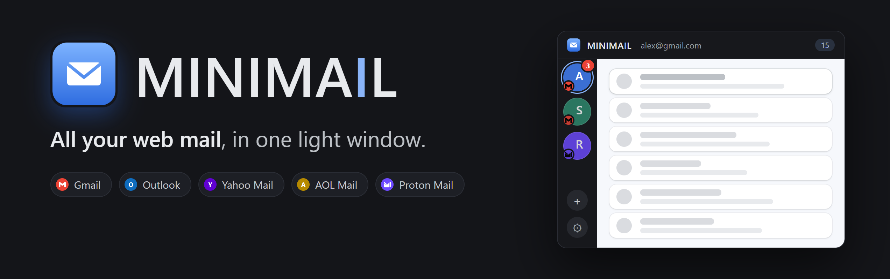
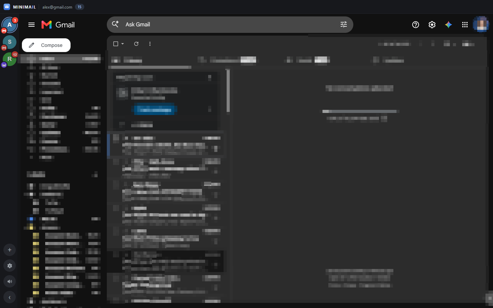
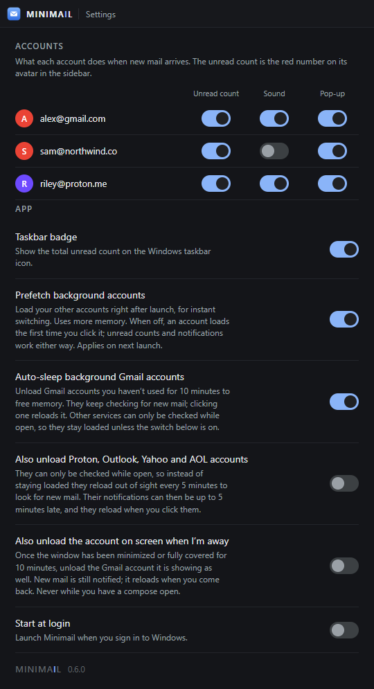
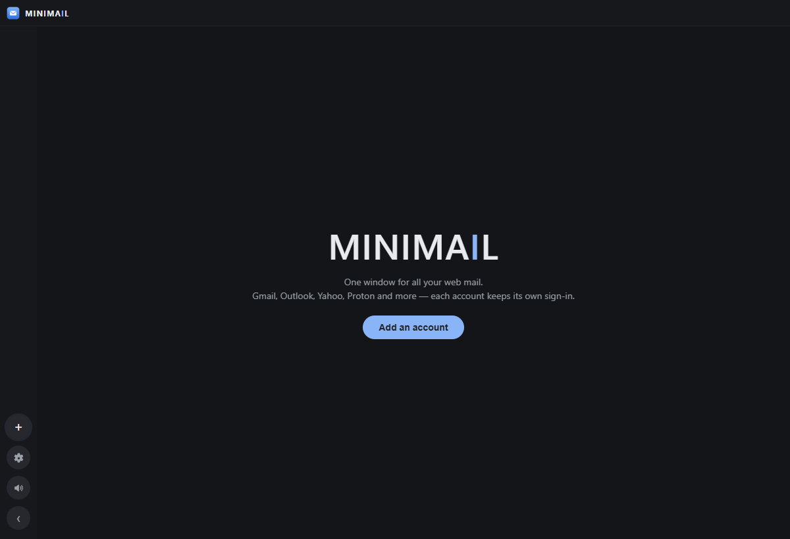

<p align="center">
  
</p>

<p align="center"><strong>One window for all your web mail.</strong> Gmail, Proton Mail, Outlook, Yahoo and AOL — each account in its own tab, signed in on its own — in a shell that gets out of the way.</p>

<p align="center">
  <a href="#why-minimail">Why Minimail</a> &middot;
  <a href="#services">Services</a> &middot;
  <a href="#memory">Memory</a> &middot;
  <a href="#install">Install</a> &middot;
  <a href="#how-it-works">How it works</a> &middot;
  <a href="#development">Development</a>
</p>



*Three accounts, two Gmail and one Proton Mail, each with its service's badge and unread count. The mail is pixelated for the screenshot; the account names are made up.*

## Why Minimail

- **Every account in one window.** A column of accounts down the side, one click or <kbd>Ctrl</kbd>+<kbd>1</kbd>…<kbd>9</kbd> to switch. A small badge on each avatar says which service it is.
- **Light on memory.** The mail pages are what a mail app costs, so Minimail loads as few of them as you tell it to, and unloads the ones you are not using — without going quiet. [Measured below](#memory).
- **Nothing between you and your mail.** No ads layer, no AI, no analytics, no account of your own to create. Mail pages load exactly as their service serves them: no preload, nothing added to them, and nothing of yours passes through anyone but your mail providers.
- **Notifications that land in the right place.** For Gmail, new mail is notified even with that account's page closed, and says who it is from and what it is about. Clicking a notification switches to that account. Each account has its own switches, and one button mutes them all for a while.
- **Kept apart, as it should be.** Every account lives in its own session. Signing in to a second Gmail account never touches the first.
- **A Windows app, not a browser tab.** Its own taskbar icon and unread badge, a place in the Start menu, <kbd>mailto:</kbd> links opening in your mail, Windows' own minimize, maximize and close.

## Services

| Service | Unread count | New-mail notification | Compose from `mailto:` | Tried with a real account |
| --- | --- | --- | --- | --- |
| Gmail | from the page, and from Gmail's feed with the page closed | sender and subject | yes | yes, in daily use |
| Proton Mail | from the page | count | — | yes — signed in, count and title confirmed |
| Outlook (personal, work or school) | from the page | count | built, not tried | no |
| Yahoo Mail | from the page | count | built, not tried | no |
| AOL Mail | from the page | count | — | no |

**Gmail and Proton Mail are the only services that have been used with real accounts.** The other three are adapters kept ready: where to start and which hosts stay in the app are set, but their page-title formats are assumed and nothing has been confirmed. Adding a service is one entry in `src/providers.js`.

Gmail is also the one service that can be checked with its page closed, because it has a feed that accepts the account's own cookies. That is what lets it unload when idle and still notify, and what gives its notifications a sender and a subject. The others can only be watched while their page is open.

In Proton Mail, leave its own **"Show unread count in favicon"** setting off: with it on, Proton drops the count from its title and Minimail would always read zero.

## Memory

Minimail is a shell around web apps, and the web apps are what it costs. Measured on Windows with two Gmail accounts and one Proton Mail account, all loaded and the window hidden (private working set, the number Task Manager shows):

| What | Memory |
| --- | --- |
| Gmail, personal account | 216–245 MB |
| Gmail, Workspace account | 197–237 MB |
| Proton Mail | 224–294 MB (briefly 460 MB while it starts) |
| Minimail itself: main process, GPU, network, shell window | about 155 MB |

All three loaded: 1.1–1.2 GB. Two of them: about 640 MB. With the window in use rather than hidden it was about 40% higher in one measurement, mostly in the GPU process. Idle CPU is about 0.1%.

What Minimail itself adds is the last row, and it is close to the floor for Electron. The Chromium settings tried were not worth taking: reserving no spare renderer changed nothing, another graphics backend saved 9 MB, and forcing a hidden page to release memory saved 5%. The rest is the pages, so what helps is loading fewer of them, and that is left to you:

- **Prefetch background accounts, off.** Only the account you start on is loaded; the others load when first clicked.
- **Auto-sleep.** A Gmail account you have not used for 10 minutes unloads, keeps checking for new mail, and reloads when clicked.
- **Also unload Proton, Outlook, Yahoo and AOL accounts.** They unload too, and reload out of sight every 5 minutes to look for new mail instead of staying loaded. Their notifications can then be up to 5 minutes late.
- **Also unload the account on screen when away.** Once the window has been minimized or fully covered for 10 minutes, the Gmail account being shown unloads too, and comes back when the window is seen again. Never while you are composing.
- **In Gmail itself**, turn *Chat and Meet* off for any account that has them: about 200 MB per account.

Auto-sleep is on by default. The two *Also unload…* switches are off, because each trades something: the first makes notifications up to 5 minutes late, the second reloads the account you were on when you come back. An account's memory is back within about a minute of it unloading.

## Install

Minimail is for Windows 10 and 11. There are no packaged releases yet, so build the installer yourself:

```
npm install
npm run dist        # -> dist/Minimail Setup <version>.exe
```

The installer installs for the current user only and is unsigned, so Windows SmartScreen asks the first time. To run straight from the source instead, `npm start`. Both use the same profile, `%APPDATA%\minimail`, so settings and sign-ins carry over.

## More of it

<table>
<tr>
<td width="50%"></td>
<td width="50%"></td>
</tr>
<tr>
<td align="center"><sub>Per-account notification switches, and the app's own.</sub></td>
<td align="center"><sub>The first run.</sub></td>
</tr>
</table>

## How it works

- **Accounts.** One shell window (title bar and sidebar) with a `WebContentsView` per account, each in its own `persist:` session partition, so sign-ins never mix. The active account loads at launch; the others load 3 seconds later unless *Prefetch background accounts* is off, in which case they load when first clicked. Click **+** to choose a service.
- **Unread counts.** While an Inbox is on screen, the count is read from the page title and matches what the service itself shows. Gmail is additionally polled once a minute, page open or not, and mail that arrives while no Inbox is showing is added to its number.
- **Notifications.** Gmail: a thread that was not in the previous poll. The others: a rise in the Inbox count, ignoring rises while a page is still filling in and counts that dip and bounce back. Clicking a pop-up switches to that account. The services' own web notifications are turned off, so nothing arrives twice.
- **Per account.** Each account has three switches: *Unread count* (the red number on its avatar), *Sound* and *Pop-up*. With the pop-up off but sound on, Minimail plays a short chime of its own.
- **Mute.** The speaker under the gear silences sound and pop-ups for every account at once, for 15 minutes, 1 hour, 4 hours, or until you turn it back on. It survives a restart, and a timed mute runs out on its own. Unread counts keep counting.
- **Auto-sleep.** A background Gmail account unloads after 10 minutes; counts and notifications keep working, and clicking it reloads it.
- **Also unload the other services.** Proton, Outlook, Yahoo and AOL accounts unload like Gmail ones do, and since nothing can check them with their page closed, their page is loaded out of sight every 5 minutes instead: not in the window, read once its count has settled, closed again. A rise is real, and so is a drop, except a drop to zero, which has to hold for a while after the page finished loading, because these pages report zero while starting up. A check that lands on a sign-in page is never repeated: that is what puts passkey prompts on screen. It waits for the account to be opened.
- **Also unload the account on screen when away.** Chromium reports when a window has gone out of sight — minimized, or fully covered — through the page's visibility, the same signal it throttles pages on. After 10 minutes of that, the Gmail account being shown unloads too, and comes back when the window is seen again. Only a service with a feed can be, so that nothing stops notifying, and never while something is in progress: a compose box in the page, a focused text field, or a window of that account open.
- **Links.** Each service's own site and sign-in flow stay in the app. Everything else opens in your default browser. Ctrl+click opens a background browser tab.
- **Downloads.** Attachments are saved straight to your `Downloads` folder, and a toast in the title bar offers *Open* and *Folder*. Two files with the same name never overwrite each other.
- **Popups.** A page's own windows (pop-out compose, print) open as child windows in the same session.
- **Avatars.** Gmail accounts show your Google profile photo, cached in `settings.json`. Other accounts show the first letter of their address. Until an address is known, the avatar is the service's mark (Gmail, Proton Mail) or its initial.
- **Service badge.** A small badge on the lower-left of each avatar says which service the account is on: the Gmail or Proton Mail outline in the service's colour, or the service's initial where it has no outline.
- **Title bar.** The logo and the wordmark on the left, then the active account and the unread total as a small chip. The minimize, maximize and close buttons are Windows' own, drawn over the right end of the bar: Minimail sets their height and symbol colour, but Windows decides their shape and hover colours.

## Shortcuts

| Keys | Action |
| --- | --- |
| `Ctrl+1` … `Ctrl+9` | Switch to account N |
| `Ctrl+Shift+B` | Hide or show the sidebar — a thin `›` strip stays clickable when hidden. Inside a text field the page keeps it (Gmail's bold, add Bcc) |
| `F5` / `Ctrl+R` | Reload the mail window that has focus, or the active account |
| `F12` / `Ctrl+Shift+I` | DevTools for the focused view |

Right-click for Cut, Copy and Paste, and for link and image actions. Right-click an account for *Load/Reload*, *Refresh avatar* (Gmail) and *Remove account* (it asks first, then clears that account's saved sign-in).

## Settings

The gear at the bottom of the sidebar. **Accounts** has one row per account with its *Unread count*, *Sound* and *Pop-up* switches. **App** has the taskbar badge, prefetch, the three unloading switches, and start at login.

`%APPDATA%\minimail\settings.json` (the previous version is kept as `settings.bak.json`):

```json
{
  "accounts": [{
    "id": "…", "provider": "gmail", "label": "you@gmail.com",
    "notify": { "count": true, "sound": true, "banner": true },
    "avatar": "data:image/jpeg;base64,…", "avatarSize": 128
  }],
  "activeId": "…",
  "sidebarCollapsed": false,
  "prefetchAccounts": true,
  "showBadge": true,
  "sleepAccounts": true,
  "dozeOthers": false,
  "sleepWhenAway": false,
  "launchOnStartup": false,
  "mutedUntil": 0
}
```

A missing `notify` switch means "on". `mutedUntil` is when the mute ends, in milliseconds; `0` is not muted, and `8640000000000000` is "until I turn it back on".

## Known limits

- Minimail shows each service's own website, so its look and its speed are that website's.
- Accounts of services other than Gmail are shown as "Outlook", "Yahoo Mail" and so on until an address shows up in their page title. Accounts can't be renamed.
- The unread count is the one the service shows for the Inbox. Mail read on another device isn't subtracted until that account's Inbox is next on screen.
- Gmail's feed reports its own total, which counts differently and can be far higher than the Inbox number. It is only shown for a Gmail account that has not displayed its Inbox since the app started.
- Reading the count from the title needs the service's interface language to be English ("Inbox").
- New mail that arrives while you have a conversation open is notified when you go back to the Inbox.
- With *Also unload the other services* on, the count of a Proton, Outlook, Yahoo or AOL account is only as fresh as its last check. Each check loads the page for about 10 seconds.
- With *Also unload the account on screen when away* on, coming back to Minimail after more than 10 minutes away reloads the account you were on. A compose box in the page, or a pop-out window of that account, keeps it loaded; a conversation you had open does not.
- Pasting images into a compose box, and attachment downloads, have only been tried with Gmail.
- No tray: closing the window quits the app. Windows only.

## Development

Plain CommonJS and vanilla JavaScript on Electron, with no build step: `src/main.js` is the app. There is nothing to compile and no runtime dependency beyond Electron itself.

| Where | What |
| --- | --- |
| `src/main.js` | The app: window, sessions, account views, IPC, unread counts, unloading |
| `src/providers.js` | One entry per service: where to start, which hosts stay, how to read its title, its colour and mark |
| `src/parsers.js` | Pure functions — titles, Gmail's feed, new-mail detection, the check-in rule — with the unit tests next door |
| `src/shell/`, `src/settings/` | The title bar and sidebar, and the Settings window |
| `src/preloads/shell.js` | The only bridge into a page. Mail pages get none. |
| `src/badge.js`, `src/png.js`, `src/marks.js` | The taskbar badge, a small PNG encoder, the service outlines |
| `src/diagnostics.js` | The offline test harness |
| `src/bench.js` | The memory measurement |
| `scripts/` | The icon, the banner, the outlines, the demo settings for screenshots |

### Tests

```
npm test            # unit tests: no browser, no dependencies
npm run autotest    # smoke test: the bridge, layout, IPC guards, the download toast
npm run experiment  # end to end: downloads, links, counts, toasts, compose, unloading
```

The last two are **offline**, and it is enforced rather than intended: they run in a throwaway profile against services that exist only on `127.0.0.1`, and cancel and report any request that tries to leave the machine.

Two more modes load your real mail pages, so say so before running either: `--probe` (reports on the signed-in profile) and `--bench` (measures memory; on a copy of the profile only, in a window that is never shown, with every sign-in host refused). A third, `--online`, loads a real sign-in page, which puts passkey prompts on the screen; it refuses to run without `MINIMAIL_ALLOW_SIGNIN_PAGES=1`.

### Measuring memory

```
MINIMAIL_ALLOW_ACCOUNT_PAGES=1 MINIMAIL_BENCH_PROFILE=<a copy of the profile> npx electron . --bench
```

`--bench` prints what each process costs over a fixed timeline, so two runs compare: `MINIMAIL_BENCH_PLAN=plain` just settles, `frames` lists which process holds what, `doze` watches accounts unload and check in, `linger` times how soon an unloaded account's memory is back. `MINIMAIL_BENCH_SWITCHES` passes Chromium switches to try. The copy holds sign-ins: delete it afterwards. The numbers in [Memory](#memory) came from here.

### The images

```
npm run banner      # docs/media/banner.png, from the app's own logo, wordmark and marks
```

The screenshots are the app itself. `npx electron . --shot` renders the sidebar, or with `SHOT=settings` the Settings window, from `scripts/demo-settings.json`, whose account names are invented. The main window is `--bench` with `MINIMAIL_BENCH_PLAN=shot` and `MINIMAIL_SHOT_OUT=<png>`: invented names and counts in Minimail's own chrome, and the mail page pixelated wherever mail is.

### Timing overrides, for tests

`MINIMAIL_SLEEP_MS` and `MINIMAIL_POLL_MS` (auto-sleep delay and polling interval), `MINIMAIL_DOZE_MS` (time between checks), `MINIMAIL_SETTLE_MS` and `MINIMAIL_ZERO_MS` (how long a checked page's count must hold, and how long a zero must), `MINIMAIL_CHECKIN_MS` (how long a check may last). `MINIMAIL_DEBUG=1` enables verbose logging.

## Credits

Inspired by Kiwi for Gmail.

The Gmail and Proton Mail outlines come from [Simple Icons](https://simpleicons.org), released into the public domain. Gmail, Proton Mail, Outlook, Yahoo Mail and AOL are names and marks of their owners, and Minimail is not affiliated with or endorsed by any of them: it shows each service's own website, where you sign in as you would in a browser.
